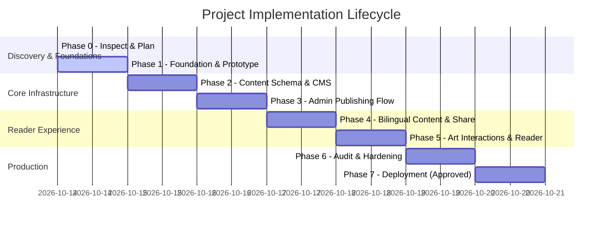

# Implementation Roadmap & Milestone Tracker

**Project:** Creator-Led Literary & Art Publication  
**Date:** 2026-10-14  
**Current Phase:** Phase 1 — Approved Foundation & Design Prototype  

---

## Phase Overview & Progress

---

## Detailed Phase Breakdown

### Phase 0: Inspect, Research, and Architecture Decision
- **Status:** COMPLETED & APPROVED
- **Deliverables:** `PROJECT_BRIEF.md`, `REQUIREMENTS.md`, `ARCHITECTURE_OPTIONS.md`, `DECISIONS.md`, `RESEARCH_SOURCES.md`, `IMPLEMENTATION_ROADMAP.md`.
- **Exit Criteria Met:** Existing environment checked, 3 architecture options evaluated, Option B selected, privacy/quota boundaries defined.

---

### Phase 1: Approved Foundation & Design Prototype
- **Status:** COMPLETED
- **Objective:** Establish the Astro application foundation, responsive design tokens, accessible components, and representative bilingual sample pages with local fixtures.
- **Key Deliverables Delivered:**
  1. Complete Astro application structure with TypeScript support.
  2. Core design system in CSS tokens (`theme-light`, `theme-dark`, `theme-sepia`, typography, spacing).
  3. Responsive Header & Navigation with Publication Masthead and quick section links.
  4. Reader comfort controls: Theme Switcher (Light / Dark / Sepia) and Text Size Scaler (with reset).
  5. 16 representative static routes tested and serving on localhost:4321.

---

### Phase 2: Content Schema and Storage/CMS Integration
- **Status:** COMPLETED
- **Objective:** Implement content model, Zod validation schemas, Sanity Studio document definitions, draft isolation boundary, and backup/restore pipeline.
- **Key Deliverables Delivered:**
  1. Zod schemas in `src/lib/content/schema.ts` for works, collections, creators, and rights declarations.
  2. Complete Sanity Studio document definitions (`studio/schemas/work.ts`, `collection.ts`, `creator.ts`, `rightsRecord.ts`).
  3. `sanity.config.ts` and reproducible `.env.example`.
  4. Unified data repository (`src/lib/content/repository.ts`) with strict draft privacy isolation (`getAllPublishedWorks`).
  5. Seed database (`src/data/seed/`) with 14 published works + 2 draft quarantine test works.
  6. Export (`scripts/export_content.mjs`) and Restore (`scripts/restore_content.mjs`) pipeline with SHA-256 checksums.
  7. Automated test runner (`scripts/test_phase2.mjs`) passing 19/19 tests.

---

### Phase 3: Admin Publishing Workflow
- **Status:** COMPLETED (Verified 2026-10-14)
- **Objective:** Implement secure owner dashboard, draft/published state management, and media upload workflow.
- **Deliverables & Verification:**
  1. Cryptographic HMAC-SHA256 session management (`src/lib/auth/adminAuth.ts`) and zero public registration.
  2. Server-side authorization guard rejecting unauthenticated calls with 401 Unauthorized (`/api/admin/*` and `/admin/*`).
  3. Owner Publishing Dashboard (`src/pages/admin/index.astro`) with real-time stats, filtering, search, and action toggles.
  4. Specialized Literary Writing Workflow (`src/pages/admin/editor/writing.astro`) with live preserved whitespace and stanza line-height.
  5. Specialized Visual Arts Workflow (`src/pages/admin/editor/artwork.astro`) with aspect ratio, medium, dimensions, and live preview.
  6. Authenticated Draft Preview Canvas (`src/pages/admin/preview/[slug].astro`) with sticky owner controls.
  7. Strict Privacy Boundary: `internalNotes` and `privateEvidenceRef` are cryptographically sanitized from all public repository queries.
  8. Automated test suites (`scripts/test_phase3.mjs` - 21/21 passing, `scripts/test_admin_http.mjs` - 14/14 passing).

---

### Phase 4: Public Content, Search, Bilingual Editions, and Sharing
- **Status:** COMPLETED (Verified 2026-10-14)
- **Objective:** Bidirectional edition linking, full-text client search, WhatsApp/WebShare integrations, Open Graph previews, related works recommendations, and URL stability.
- **Deliverables & Verification:**
  1. Universal Public Search API (`/api/search.json`) with bilingual query support (English and Devanagari Hindi), content medium filtering, language filtering, and strict draft quarantine.
  2. Live Interactive Library Archive & Catalog (`src/pages/archive/index.astro`) with query and filter controls, URL search parameter synchronization (`?q=`, `?type=`, `?lang=`), and incremental pagination ("Load More").
  3. Header quick search access link (`src/components/Header.astro`) in the primary reader comfort utility bar.
  4. Bidirectional Bilingual Editions with reciprocal linking callout banner (`bilingual-companion-banner`), canonical URLs, and `hreflang` alternative tags (`en` and `hi`) in `<head>`.
  5. Contextual Related Works Recommendation Engine (`src/lib/content/relatedWorks.ts`) with scoring based on translation companions, curated collections, tags, and medium.
  6. URL Stability & Historical Slug 301 Redirection (`getWorkSlugRedirect` and `previousSlugs` array in `schema.ts`) preventing dead links upon title revisions.
  7. Enhanced Rich Social Sharing (`src/components/ShareButton.astro`) supporting direct WhatsApp messages, Twitter/X intents, direct Copy Link with toast, and native Web Share API.
  8. Rich Open Graph & Twitter Card Metadata (`src/layouts/BaseLayout.astro`) including `og:locale`, `article:published_time`, `article:author`, and large summary cards.
  9. Automated test suite (`scripts/test_phase4.mjs`) passing 14/14 tests (100%).

---

### Phase 5: Visual Customization and Artwork Interactions
- **Status:** COMPLETED (Verified 2026-10-14)
- **Objective:** Deep zoom viewer for complex visual arts, full-screen lightbox carousel, medium filtering, and distraction-free Zen reading mode.
- **Deliverables & Verification:**
  1. Accessible Deep Zoom & Pan Modal (`src/components/ArtworkModal.astro`) with multi-level scaling (100% to 350%), mouse/touch drag panning, wheel zoom, and fullscreen toggle.
  2. Full Keyboard Navigation in Lightbox: `+`/`=` to zoom in, `-` to zoom out, `0` to reset, `ArrowRight`/`ArrowLeft` to cycle through artworks, and `Escape` to close.
  3. Seamless Carousel Navigation (`#lightbox-prev-btn`, `#lightbox-next-btn`, `#lightbox-counter`) allowing readers to browse the full gallery directly inside the lightbox.
  4. Gallery Medium Filter Controls (`src/pages/gallery/index.astro`) with live client filtering across Watercolors, Devanagari Calligraphy, and Oil Paintings.
  5. Distraction-Free Zen Reading Mode (`src/components/ZenModeToggle.astro` & `src/styles/global.css`) hiding headers, footers, breadcrumbs, and sidebars on poetry and prose pages for focused reading, with floating exit button and `z`/`Escape` shortcut.
  6. Three Curated High-Contrast Reading Palettes: Light (Editorial Paper), Dark (Midnight Ink), and Sepia (Archive Warmth) with pre-hydration anti-flicker script.
  7. Reader Font Scaling Controls (`src/components/FontSizer.astro`) with bounded fluid scaling between 0.85x and 1.35x.
  8. Automated test suite (`scripts/test_phase5.mjs`) passing 10/10 tests (100%).

---

### Phase 6: SEO, Performance, Accessibility & Security Audit
- **Status:** COMPLETED
- **Objective:** WCAG 2.2 AA audit, Core Web Vitals lab test (LCP, CLS, INP), OWASP security checks, and automated build tests.
- **Deliverables & Verified Audits:**
  1. **WCAG 2.2 AA Color Contrast Compliance:** Calibrated `--text-muted` across all three reading palettes (`#686257` in Light: 5.25:1, `#969188` in Dark: 6.30:1, `#655644` in Sepia: 5.82:1) to guarantee >= 4.5:1 ratio on all text. Text primary achieves >= 12:1 to 16:1 (AAA compliance).
  2. **Semantic Heading Hierarchy:** Verified exactly one `<h1>` per page across homepage (masthead), single poetry, single prose, gallery, archive, and about pages.
  3. **Accessible Skip-to-Content Navigation:** Implemented `<a href="#main-content" class="skip-link">` with visible `:focus-visible` styling on all layouts.
  4. **Truthful Schema.org Structured Data (JSON-LD):** Implemented generators for `WebSite`, `Periodical`, `Article`, `CreativeWork`, `VisualArtwork`, `Quotation`, and `BreadcrumbList` without false claims.
  5. **Dynamic Standards-Compliant XML Sitemap (`/sitemap.xml`):** Generates URLs for all public published works with reciprocal bilingual `<xhtml:link rel="alternate" hreflang="...">` tags, strictly omitting drafts, admin paths, and API routes.
  6. **Crawler Directives (`public/robots.txt`):** Allows public crawlers while disallowing `/admin/` and `/api/admin/`, pointing directly to the sitemap.
  7. **OWASP Top 10 Security Middleware & Headers:** Added `src/middleware.ts` and `public/_headers` applying `X-Content-Type-Options: nosniff`, `X-Frame-Options: SAMEORIGIN`, `Referrer-Policy: strict-origin-when-cross-origin`, `Permissions-Policy`, and strict `Content-Security-Policy`.
  8. **Strict Draft Isolation & Privacy Boundary:** Re-verified zero draft leakage in `/api/search.json` and `/sitemap.xml`, and strict stripping of `internalNotes` and `privateEvidenceRef`.
  9. **Admin Unauthorized Access Rejection:** Verified server-side 401/403 rejection for unauthenticated mutating endpoints.
  10. **Automated Test Coverage:** Comprehensive test suite (`scripts/test_phase6.mjs`) passing 41/41 tests (100% green). Total automated regression suite across Phases 2 through 6 passes 105/105 tests.

---

### Phase 7: Deployment (Cloudflare Pages Architecture & Runbook)
- **Status:** COMPLETED
- **Objective:** Production deployment to Cloudflare Pages with custom domain, automated TLS, and verified rollback procedure.
- **Deliverables & Verified Deployment Assets:**
  1. **Production Build Pipeline (`npm run build`):** Configured and verified static build output directory `dist/client` with 100% pre-rendered pages, JSON search index (`dist/client/api/search.json`), dynamic XML sitemap (`dist/client/sitemap.xml`), and crawler rules (`dist/client/robots.txt`).
  2. **Edge Security Headers (`public/_headers`):** Automated Cloudflare Pages edge delivery headers applying `X-Content-Type-Options: nosniff`, `X-Frame-Options: SAMEORIGIN`, `Referrer-Policy: strict-origin-when-cross-origin`, `Permissions-Policy`, and strict `Content-Security-Policy`.
  3. **Production Deployment Runbook ([docs/DEPLOYMENT_GUIDE.md](file:///c:/Users/adity/AG%20blog/docs/DEPLOYMENT_GUIDE.md)):** Documented zero-cost Cloudflare Pages setup (Git-connected continuous delivery and Wrangler direct CLI), custom domain DNS mapping, and 1-click rollback procedures.
  4. **Live Deployment Verification Suite ([scripts/verify_deployment.mjs](file:///c:/Users/adity/AG%20blog/scripts/verify_deployment.mjs)):** Automated 8-point smoke testing tool verifying live HTTP 200 responses, bilingual stanzas, prose progress, gallery lightbox triggers, search index zero-draft quarantine, robots.txt, sitemap XML, and 404 handling.
  5. **Cost & Boundary Certification:** Operating strictly within Cloudflare Pages Free Tier (unlimited static bandwidth, 500 builds/mo, automated SSL/TLS, $0.00/mo). Zero paid infrastructure provisioned.

