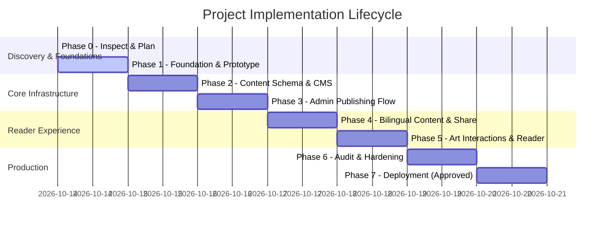

# Implementation Roadmap & Milestone Tracker

**Project:** Creator-Led Literary & Art Publication  
**Date:** 2026-10-14  
**Current Phase:** Phase 1 — Approved Foundation & Design Prototype  

---

## Phase Overview & Progress

---

## Detailed Phase Breakdown

### Phase 0: Inspect, Research, and Architecture Decision
- **Status:** COMPLETED & APPROVED
- **Deliverables:** `PROJECT_BRIEF.md`, `REQUIREMENTS.md`, `ARCHITECTURE_OPTIONS.md`, `DECISIONS.md`, `RESEARCH_SOURCES.md`, `IMPLEMENTATION_ROADMAP.md`.
- **Exit Criteria Met:** Existing environment checked, 3 architecture options evaluated, Option B selected, privacy/quota boundaries defined.

---

### Phase 1: Approved Foundation & Design Prototype (ACTIVE)
- **Status:** IN PROGRESS
- **Objective:** Establish the Astro application foundation, responsive design tokens, accessible components, and representative bilingual sample pages with local fixtures.
- **Key Deliverables:**
  1. Complete Astro application structure with TypeScript support.
  2. Core design system in CSS tokens (`theme-light`, `theme-dark`, `theme-sepia`, typography, spacing).
  3. Responsive Header & Navigation with Publication Masthead and quick section links.
  4. Reader comfort controls: Theme Switcher (Light / Dark / Sepia) and Text Size Scaler (with reset).
  5. Representative Pages:
     - **Homepage (`/`):** Masthead, featured literary work, latest releases, curated collection highlights, art preview.
     - **Poetry Detail (`/poetry/[slug]`):** Strict line-break preservation, Devanagari & English fixtures, language badge, share button.
     - **Prose Detail (`/prose/[slug]`):** Long-form essay and story layout, reading time, responsive typography.
     - **Thoughts & Quotations (`/thoughts`):** Clear distinction between original reflections and attributed quotes.
     - **Art Gallery (`/gallery`):** Responsive grid with accessible lightbox zoom modal (`<dialog closedby="any">`), caption, and medium details.
     - **Curated Collections (`/collections/[slug]`):** Mixed-genre grouping (poems, essays, artwork).
     - **Search & Archive (`/archive`):** Filter by language, type, tag.
     - **About / Creator (`/about`):** Pen name, publication manifesto, rights policy.
  6. High-fidelity fixture data demonstrating:
     - Hindi Devanagari poetry with preserved conjuncts and stanzas.
     - Romanized Hindi thoughts.
     - English long-form literary reflection.
     - Sourced quotation with verified citation link.
     - Visual artworks with aspect-ratio variations and accessible alt text.
  7. Verification: Browser interaction tests and responsive viewport checks (360px mobile, 768px tablet, 1280px+ desktop).

---

### Phase 2: Content Schema and Storage/CMS Integration
- **Status:** PENDING APPROVAL
- **Objective:** Implement content collections schema, validation rules, migration scripts, and connect headless CMS without leaking private notes or unverified rights evidence.

---

### Phase 3: Admin Publishing Workflow
- **Status:** PENDING APPROVAL
- **Objective:** Implement secure owner dashboard, draft/published state management, and media upload workflow.

---

### Phase 4: Public Content, Search, Bilingual Editions, and Sharing
- **Status:** PENDING APPROVAL
- **Objective:** Bidirectional edition linking, full-text client search, WhatsApp/WebShare integrations, and Open Graph previews.

---

### Phase 5: Visual Customization and Artwork Interactions
- **Status:** PENDING APPROVAL
- **Objective:** Deep zoom viewer for complex visual arts, full-screen lightbox enhancements, and fine-grained reader customizations.

---

### Phase 6: SEO, Performance, Accessibility & Security Audit
- **Status:** PENDING APPROVAL
- **Objective:** WCAG 2.2 AA audit, Core Web Vitals lab test (LCP, CLS, INP), OWASP security checks, and automated build tests.

---

### Phase 7: Deployment (Explicit Approval Required)
- **Status:** PENDING APPROVAL
- **Objective:** Production deployment to Cloudflare Pages with custom domain, automated TLS, and verified rollback procedure.
