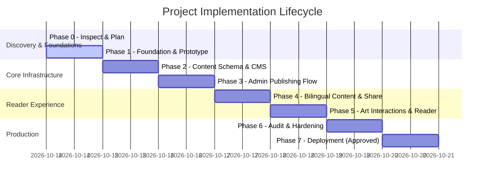

# Implementation Roadmap & Milestone Tracker

**Project:** Creator-Led Literary & Art Publication  
**Date:** 2026-10-14  
**Current Phase:** Phase 1 — Approved Foundation & Design Prototype  

---

## Phase Overview & Progress

---

## Detailed Phase Breakdown

### Phase 0: Inspect, Research, and Architecture Decision
- **Status:** COMPLETED & APPROVED
- **Deliverables:** `PROJECT_BRIEF.md`, `REQUIREMENTS.md`, `ARCHITECTURE_OPTIONS.md`, `DECISIONS.md`, `RESEARCH_SOURCES.md`, `IMPLEMENTATION_ROADMAP.md`.
- **Exit Criteria Met:** Existing environment checked, 3 architecture options evaluated, Option B selected, privacy/quota boundaries defined.

---

### Phase 1: Approved Foundation & Design Prototype
- **Status:** COMPLETED
- **Objective:** Establish the Astro application foundation, responsive design tokens, accessible components, and representative bilingual sample pages with local fixtures.
- **Key Deliverables Delivered:**
  1. Complete Astro application structure with TypeScript support.
  2. Core design system in CSS tokens (`theme-light`, `theme-dark`, `theme-sepia`, typography, spacing).
  3. Responsive Header & Navigation with Publication Masthead and quick section links.
  4. Reader comfort controls: Theme Switcher (Light / Dark / Sepia) and Text Size Scaler (with reset).
  5. 16 representative static routes tested and serving on localhost:4321.

---

### Phase 2: Content Schema and Storage/CMS Integration
- **Status:** COMPLETED
- **Objective:** Implement content model, Zod validation schemas, Sanity Studio document definitions, draft isolation boundary, and backup/restore pipeline.
- **Key Deliverables Delivered:**
  1. Zod schemas in `src/lib/content/schema.ts` for works, collections, creators, and rights declarations.
  2. Complete Sanity Studio document definitions (`studio/schemas/work.ts`, `collection.ts`, `creator.ts`, `rightsRecord.ts`).
  3. `sanity.config.ts` and reproducible `.env.example`.
  4. Unified data repository (`src/lib/content/repository.ts`) with strict draft privacy isolation (`getAllPublishedWorks`).
  5. Seed database (`src/data/seed/`) with 14 published works + 2 draft quarantine test works.
  6. Export (`scripts/export_content.mjs`) and Restore (`scripts/restore_content.mjs`) pipeline with SHA-256 checksums.
  7. Automated test runner (`scripts/test_phase2.mjs`) passing 19/19 tests.

---

### Phase 3: Admin Publishing Workflow
- **Status:** COMPLETED (Verified 2026-10-14)
- **Objective:** Implement secure owner dashboard, draft/published state management, and media upload workflow.
- **Deliverables & Verification:**
  1. Cryptographic HMAC-SHA256 session management (`src/lib/auth/adminAuth.ts`) and zero public registration.
  2. Server-side authorization guard rejecting unauthenticated calls with 401 Unauthorized (`/api/admin/*` and `/admin/*`).
  3. Owner Publishing Dashboard (`src/pages/admin/index.astro`) with real-time stats, filtering, search, and action toggles.
  4. Specialized Literary Writing Workflow (`src/pages/admin/editor/writing.astro`) with live preserved whitespace and stanza line-height.
  5. Specialized Visual Arts Workflow (`src/pages/admin/editor/artwork.astro`) with aspect ratio, medium, dimensions, and live preview.
  6. Authenticated Draft Preview Canvas (`src/pages/admin/preview/[slug].astro`) with sticky owner controls.
  7. Strict Privacy Boundary: `internalNotes` and `privateEvidenceRef` are cryptographically sanitized from all public repository queries.
  8. Automated test suites (`scripts/test_phase3.mjs` - 21/21 passing, `scripts/test_admin_http.mjs` - 14/14 passing).

---

### Phase 4: Public Content, Search, Bilingual Editions, and Sharing
- **Status:** PENDING APPROVAL
- **Objective:** Bidirectional edition linking, full-text client search, WhatsApp/WebShare integrations, and Open Graph previews.

---

### Phase 5: Visual Customization and Artwork Interactions
- **Status:** PENDING APPROVAL
- **Objective:** Deep zoom viewer for complex visual arts, full-screen lightbox enhancements, and fine-grained reader customizations.

---

### Phase 6: SEO, Performance, Accessibility & Security Audit
- **Status:** PENDING APPROVAL
- **Objective:** WCAG 2.2 AA audit, Core Web Vitals lab test (LCP, CLS, INP), OWASP security checks, and automated build tests.

---

### Phase 7: Deployment (Explicit Approval Required)
- **Status:** PENDING APPROVAL
- **Objective:** Production deployment to Cloudflare Pages with custom domain, automated TLS, and verified rollback procedure.
