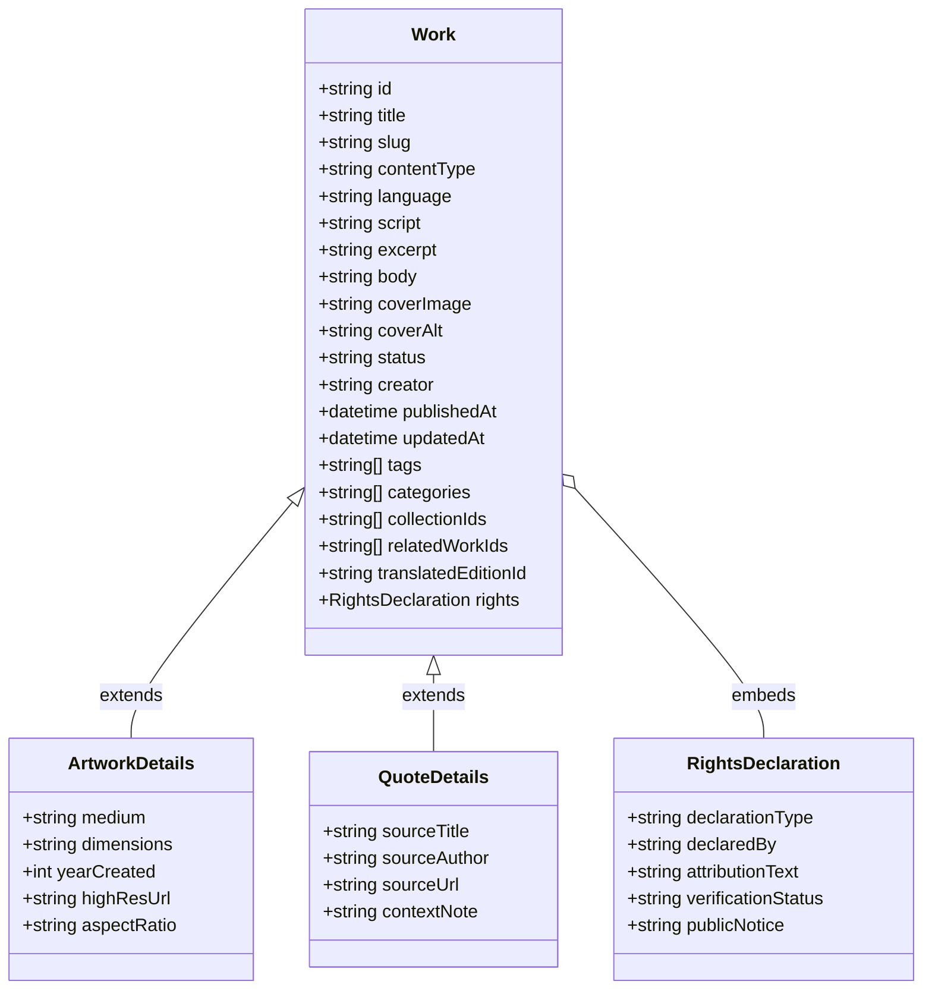

# Requirements & Traceability Matrix — Literary & Art Publication

**Date:** 2026-10-14  
**Status:** Approved for Implementation (Phase 1 Foundation Active)  

---

## 1. Functional Requirements

| ID | Category | Requirement Description | Component / Model | Test / Verification Method | Status |
|---|---|---|---|---|---|
| **REQ-F01** | Editorial Front Page | Curated masthead, hero featured work, latest releases, curated thematic collections, section links. | `Homepage.astro`, `FeaturedGrid.astro` | Browser inspection; mobile/desktop screenshot verification. | In Progress |
| **REQ-F02** | Poetry Display | Strict line-break and stanza preservation, Devanagari typography, Romanized script options, language badge. | `PoemCard.astro`, `pages/poetry/[slug].astro` | Automated line-break test; visual review with Devanagari conjuncts and long stanzas. | In Progress |
| **REQ-F03** | Long-form Prose | Story, essay, and reflection layouts with readable widths (65–75ch), drop caps, reading time estimate, footnotes. | `ProseLayout.astro`, `pages/prose/[slug].astro` | Viewport resizing, typographic hierarchy inspection, readability test. | In Progress |
| **REQ-F04** | Thoughts vs. Quotes | Distinguish original aphorisms from attributed quotes; verify source URL and citation field. | `ThoughtCard.astro`, `QuoteCard.astro` | Content schema validation; UI distinction test (attribution badges). | In Progress |
| **REQ-F05** | Art Gallery | Responsive masonry/grid, aspect-ratio handling, accessible lightbox zoom modal with keyboard controls. | `GalleryGrid.astro`, `ArtworkModal.astro` | `<dialog closedby="any">` click/keyboard dismiss, pinch/zoom simulation. | In Progress |
| **REQ-F06** | Curated Collections | Group poems, essays, and art under an editorial collection slug without duplicating underlying content. | `CollectionCard.astro`, `pages/collections/[slug].astro` | Relational lookup test; cross-type rendering check. | In Progress |
| **REQ-F07** | Search & Archives | Client-side search and filtering across titles, tags, categories, languages, and content types. | `SearchWidget.astro`, `FilterBar.astro` | Substring query tests (English & Devanagari text), zero-results state. | In Progress |
| **REQ-F08** | Bilingual Linking | Link Hindi and English editions bidirectionally with canonical tags and clear language switcher. | `LanguageSwitcher.astro`, `EditionBadge.astro` | Reciprocal link check; hreflang metadata validation. | In Progress |
| **REQ-F09** | Social Sharing | Native Web Share API with clipboard fallback, dedicated WhatsApp share link, canonical Open Graph metadata. | `ShareButton.astro`, `SEOHead.astro` | Share trigger click test; Open Graph tag linting. | In Progress |

---

## 2. UX, Accessibility & Design Requirements

| ID | Category | Requirement Description | Component / Design System | Verification | Status |
|---|---|---|---|---|---|
| **REQ-UX01** | Theme Switcher | Reader themes: Light (Editorial Paper), Dark (Midnight Ink), Sepia (Archive Warmth). Client-side only. | `ThemeToggle.astro`, `index.css` | LocalStorage persistence, `data-theme` attribute, `color-scheme` adaptation. | In Progress |
| **REQ-UX02** | Font Resizer | Reader-controlled font scaling (0.875rem to 1.375rem) with instant reset option. | `FontSizer.astro`, `index.css` | LocalStorage state test, layout shift check, container reflow. | In Progress |
| **REQ-UX03** | Typography | High-contrast, elegant serif & sans pairs: `Playfair Display`/`Cinzel` + `Newsreader` + `Noto Serif Devanagari` + `Inter`. | `@fontsource` / Google Fonts import | Visual Devanagari conjuncts check, line-height verification. | In Progress |
| **REQ-UX04** | Accessibility | Target WCAG 2.2 AA; semantic headings, visible focus rings, dialog focus trapping, aria labels, reduced motion. | All components | Keyboard tab navigation, high contrast ratio verification, `prefers-reduced-motion`. | In Progress |
| **REQ-UX05** | Mobile Viewports | Fluid responsive design for viewports 320px–390px, 768px, 1024px, 1440px+ without horizontal scroll. | CSS media & container queries | Chrome DevTools device mode screenshots. | In Progress |

---

## 3. Privacy, Security & Data Boundaries

| ID | Category | Requirement Description | Architecture Decision | Verification | Status |
|---|---|---|---|---|---|
| **REQ-S01** | Zero Token Leak | No private API keys or CMS write tokens bundled into client JavaScript. | Static generation (SSG) | Bundle audit, `.env.example` review, grep client assets. | Enforced |
| **REQ-S02** | Rights Isolation | Private rights notes and confidential legal evidence kept off public datasets and CDNs. | Schema separation: public vs private | Content schema inspection; verify no private fields in public JSON. | Enforced |
| **REQ-S03** | Draft Protection | Unpublished drafts must never appear in production static builds, sitemaps, or search indexes. | Build-time filter (`status === 'published'`) | Automated build test checking draft exclusions. | Enforced |
| **REQ-S04** | Input Sanitization | Prevent stored XSS in poem/prose body; safe rendering without unsanitized `innerHTML`. | Markdown parser with HTML entity escaping | Test payload with `<script>` tags in fixture files. | Enforced |

---

## 4. Content Schema Traceability

